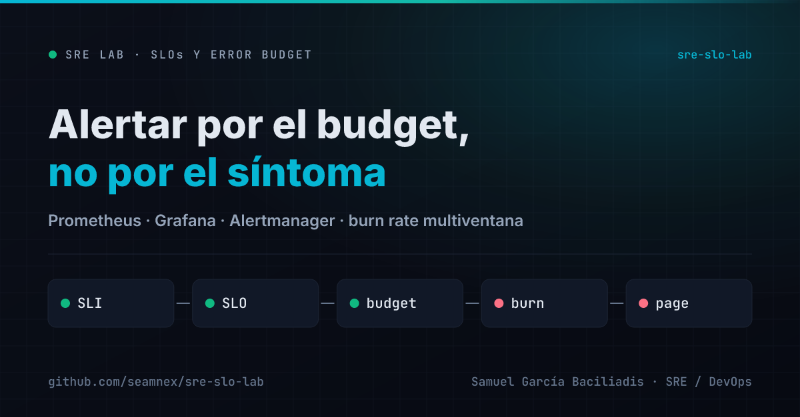
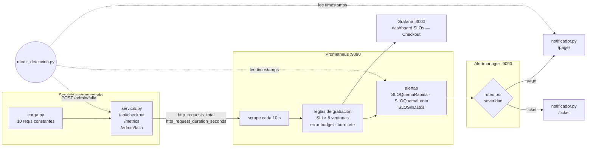
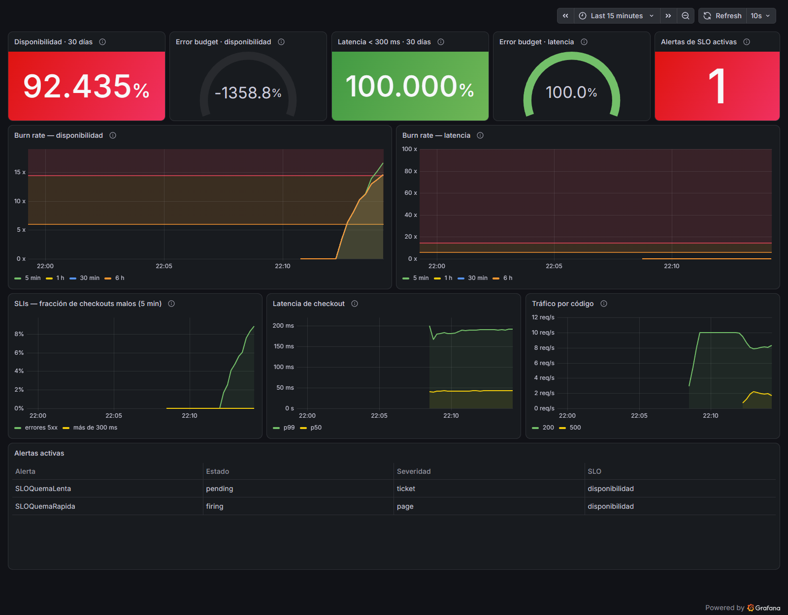

# SRE SLO Lab — Alertar por el error budget, no por el síntoma

[](https://github.com/seamnex/sre-slo-lab/actions/workflows/validar.yml)



SLIs, SLOs y error budget sobre un servicio instrumentado, con alertas por
**burn rate multiventana**, un dashboard de Grafana versionado y una cadena
completa —falla inyectada → métrica → alerta → ruteo → notificación— que se
levanta con `docker compose`.

> Parte de mi ruta de especialización en SRE / DevOps.
> Contexto: vengo de gestión de incidentes P1/P2. El
> [observability-lab](https://github.com/seamnex/observability-lab) mide el
> tiempo de detección con una regla de umbral sobre Elastic; este lab responde
> la pregunta siguiente: **¿cuándo vale la pena despertar a alguien?**

---

## El problema

Una alerta de umbral fijo —"más del 1 % de errores"— falla de las dos formas
posibles:

- **Despierta a alguien por un pico de 30 segundos** que no pone en riesgo nada.
- **No despierta a nadie por un 0,8 % sostenido durante días**, que se come
  todo el margen de error del mes sin cruzar nunca el umbral.

Y las dos fallas tienen el mismo costo a largo plazo: un equipo que aprende a
ignorar las alertas.

## La solución

Cambiar la pregunta. No "¿hay errores?" sino **"¿a este ritmo, el error budget
de 30 días se agota antes de tiempo?"**. Es el enfoque del *SRE Workbook* de
Google, implementado de punta a punta:

- **Dos SLOs** sobre el checkout: disponibilidad (99,5 %) y latencia (99 % < 300 ms).
- **Reglas de grabación** que precalculan cada SLI en 8 ventanas, de 5 minutos a 30 días.
- **Alertas por burn rate** con ventana larga (precisión) y corta (reset rápido), en dos
  severidades: *page* si el budget se agota en días, *ticket* si se agota en semanas.
- **Una alerta para el punto ciego**: si el servicio se cae entero, no hay métricas,
  y sin métricas ninguna alerta de burn rate dispara.
- **Tests unitarios de las alertas** con `promtool`: cada alerta tiene que disparar —o
  no— en un minuto exacto.

Por qué cada número es el que es: [`docs/decisiones.md`](docs/decisiones.md).

---

## Arquitectura



El notificador hace de *pager*: registra cada aviso con la hora en que llegó.
Es el último eslabón y el que define el tiempo de detección real. Una alerta
`firing` en Prometheus que nunca le llegó a nadie no detectó nada.

### Los SLOs

| SLO | SLI | Objetivo | Error budget (30 días) |
|---|---|---|---|
| Disponibilidad | checkouts sin 5xx / checkouts | 99,5 % | 0,5 % ≈ 3 h 36 min de caída total |
| Latencia | checkouts en < 300 ms / checkouts | 99 % | 1 % de checkouts lentos |

### Las alertas

| Alerta | Condición | Severidad | `for` |
|---|---|---|---|
| `SLOQuemaRapida` | burn 14,4× en 1 h **y** 5 min, **o** 6× en 6 h **y** 30 min | page | 1 min |
| `SLOQuemaLenta` | burn 3× en 1 d **y** 2 h, **o** 1× en 3 d **y** 6 h | ticket | 15 min |
| `SLOSinDatos` | `up == 0` o `absent(up)` | page | 1 min |

Cada alerta lleva `runbook_url` a un runbook real en
[incident-postmortems](https://github.com/seamnex/incident-postmortems).



*El dashboard durante la medición de abajo: 20 % de errores inyectados,
`SLOQuemaRapida` disparada y el burn rate de 5 min cruzando la línea de 14,4×.
El error budget en −1358 % no es un error de cálculo: con 6 minutos de
historia, la ventana "de 30 días" promedia sobre 6 minutos. Ver
[Historia corta](#lo-que-el-lab-no-puede-mostrar-historia-corta).*

---

## Requisitos

- **Docker** con Docker Compose v2
- **Python 3** (solo para el script de medición; usa la biblioteca estándar)
- Puertos libres: 3000, 8080, 9090, 9093, 9099

## Cómo levantarlo

```bash
git clone https://github.com/seamnex/sre-slo-lab.git
cd sre-slo-lab

docker compose up -d --build
docker compose ps                  # los 6 servicios Up, servicio (healthy)
```

| Qué | Dónde |
|---|---|
| Dashboard | <http://localhost:3000> (sin login) |
| Prometheus — reglas y alertas | <http://localhost:9090/alerts> |
| Alertmanager | <http://localhost:9093> |
| Notificaciones recibidas | <http://localhost:9099> |

Esperar 2 o 3 minutos a que haya historia para los `rate()`, y verificar:

```bash
curl -s 'localhost:9090/api/v1/query?query=slo:error_budget_restante:ratio'
# dos series, slo="disponibilidad" y slo="latencia", con valor 1 (budget intacto)
```

### Inyectar una falla a mano

```bash
# 20 % de errores durante 5 minutos
curl -X POST localhost:8080/admin/falla -d '{"tasa_error": 0.2, "duracion_s": 300}'

# +350 ms a cada checkout
curl -X POST localhost:8080/admin/falla -d '{"latencia_extra_ms": 350, "duracion_s": 300}'

# ver la falla activa / retirarla
curl localhost:8080/admin/falla
curl -X DELETE localhost:8080/admin/falla
```

### Medir el tiempo de detección

```bash
python scripts/medir_deteccion.py disponibilidad
python scripts/medir_deteccion.py latencia
python scripts/medir_deteccion.py caida          # detiene el contenedor del servicio
```

Inyecta la falla, registra cuándo la alerta pasa a `pending`, a `firing` y
cuándo llega la notificación; después retira la falla y mide cuánto tarda el
aviso de resolución.

### Validar sin levantar nada

```bash
# reglas
docker run --rm --entrypoint promtool -v "$PWD/prometheus:/p" -w /p \
  prom/prometheus:v3.15.1 check rules reglas/sli.yml reglas/alertas.yml

# tests unitarios de las alertas
docker run --rm --entrypoint promtool -v "$PWD/prometheus:/p" -w /p/tests \
  prom/prometheus:v3.15.1 test rules alertas_test.yml
```

### Bajar todo

```bash
docker compose down -v
```

---

## Bitácora

**Entorno:** Windows 11 · Docker Desktop 29.6.2 · Prometheus 3.15.1 ·
Alertmanager 0.34.1 · Grafana 13.2.4 · Python 3.13. **Fecha:** 06/11/2026 (UTC).

### Tests unitarios de las alertas

`promtool test rules` — 6 escenarios, todos en verde, resultado idéntico en 3
corridas seguidas:

| # | Escenario | Qué verifica |
|---|---|---|
| 1 | 20 % de errores después de **3 días** limpios | No dispara a los 15 min (la ventana de 1 h filtra), sí a los 30. La lenta **no** dispara |
| 2 | 1 % de errores sostenido | Ticket sí, page no |
| 3 | 30 % de checkouts lentos, cero errores | Dispara `slo="latencia"`, y solo ese |
| 4 | El servicio deja de reportar | Las de burn rate **no** disparan; `SLOSinDatos` sí |
| 5 | El target nunca existió | `SLOSinDatos` por `absent()` |
| 6 | Un servicio que nunca devolvió un 5xx | El SLI vale 0, no "sin datos" |

### Medición de punta a punta

Corrida con `scripts/medir_deteccion.py` sobre el stack levantado, con Prometheus
arrancado a las 01:08 UTC. Cada tiempo sale de restar timestamps: el de la
inyección, el del estado de la alerta en la API de Prometheus y el de llegada
del aviso al notificador.

| Escenario | Estado | Pending | Firing | **Notificación** | Canal | Resolución |
|---|---|---|---|---|---|---|
| Disponibilidad: 20 % de errores | ✅ completa | 60,2 s | 120,5 s | **119,8 s** | `pager` | 539,3 s después de retirar la falla |
| Latencia: +350 ms por checkout | ⏳ **en curso** | 79 s | 139 s | **138 s** | `pager` | en curso: esperando el aviso de resolución |
| Caída total del servicio | ⏳ **en curso** | — | — | — | — | todavía no corrió |

> **Medición en curso.** La fila de latencia ya tiene medida la detección; la
> resolución y el escenario de caída total están corriendo. Esta tabla se
> actualiza cuando terminen.

*La notificación figura unos milisegundos antes que el `firing` porque el
script consulta el estado cada 2 segundos: el aviso llegó entre dos consultas.*

Lo que confirmó la corrida, más allá de los números:

- **El ruteo por severidad funciona.** Las `page` llegaron al canal `pager`;
  la `ticket` (ver abajo), al canal `ticket`.
- **El ticket llegó cuando la falla ya había terminado.** `SLOQuemaLenta` de
  disponibilidad pasó a `pending` a las 01:12, disparó a los 15 minutos de
  `for` y el aviso llegó al canal `ticket` a las 01:28:32, **15 minutos después
  de retirar una falla de 2 minutos**. No es un bug del ruteo: con 4 minutos de
  historia, la ventana "de 1 día" promedia sobre minutos, y 2 minutos al 20 %
  pesan como un 3 % sostenido. Es exactamente el escenario 1 de los tests
  unitarios, que con 3 días de historia verifica que eso **no** pase.

### Dos bugs que encontré —y que los tests encontraron por mí—

**1. El test que corrigió mi razonamiento.** La primera versión del escenario 1
tenía 7 horas de historia, y afirmaba que la quema lenta no disparaba. Falló:
**sí disparaba**. Con 7,5 horas de datos, la ventana "de 3 días" promedia sobre
7,5 horas, y 30 minutos de falla pesan 1,29 % en lugar del 0,14 % que pesarían
con 3 días reales. El test no tenía un bug; lo tenía mi expectativa. Ahora el
escenario arranca con 3 días limpios, y el comentario del test explica por qué.

**2. El SLI que desaparecía cuando todo estaba bien.** Con el stack levantado,
el SLI de disponibilidad no existía. Un servicio que nunca devolvió un 5xx no
tiene la serie `code="500"`, el numerador da vacío y el SLI da "sin datos" en
vez de 0. Efecto: **el error budget desaparecía del dashboard justo cuando todo
estaba sano**. El arreglo es un `or vector(0)` en el numerador, y el escenario 6
lo cubre: verifiqué que el test falla sin el arreglo (`got: nil`) y pasa con él.

### Lo que el lab no puede mostrar: historia corta

En producción, la ventana de 1 hora tiene una hora de datos. En un stack
recién levantado tiene los minutos que lleva corriendo. Por eso:

- **El tiempo de detección medido es optimista.** Con 3 días de historia, el
  test unitario muestra que 20 % de errores todavía no dispara la page a los 15
  minutos y sí a los 30 (≈22 por cálculo: la ventana de 1 h tiene que superar
  7,2 % de errores). En el lab disparó en 2.
- **La resolución es lenta.** La ventana de 6 h promedia sobre toda la historia
  del lab, así que 2 minutos de falla la mantienen alta varios minutos después
  de retirarla.
- **El error budget se ve catastrófico** (−1358 % en la captura): la ventana de
  30 días promedia sobre minutos.

Por eso los tiempos de los tests unitarios —con historia completa— son la
referencia de cómo se comportaría en producción, y los de la medición en vivo
son la prueba de que **la cadena funciona de punta a punta**.

---

## Qué me llevo de este lab

**1. La ausencia de datos tiene que ser una alerta.** Es el hallazgo más
importante, y apareció dos veces: en el diseño (`SLOSinDatos`) y como bug real
(el SLI vacío sin errores). Las alertas sobre el valor de una métrica asumen
que la métrica existe. Cuando no existe, el silencio se lee como "todo bien".
En gestión de incidentes, "no hay alertas" es la frase que precede a los
peores War Rooms.

**2. Una alerta sin test es una hipótesis.** Escribí la quema lenta convencido
de cómo se iba a comportar, y el test me mostró que estaba equivocado. Sin
`promtool test rules`, ese error habría aparecido en producción como un ticket
inesperado —o peor, como una page que no llega—.

**3. El SLI de latencia se cuenta, no se estima.** Un p99 no se puede promediar
ni restar de un presupuesto. Contar pedidos bajo el bucket de 300 ms sí, y por
eso ese límite es un bucket exacto del histograma.

**4. El burn rate traduce errores a una decisión.** "Hay 20 % de errores" no
dice qué hacer. "A este ritmo el budget del mes se agota en 4 horas" dice que
hay que despertar a alguien ya, y "se agota en 3 semanas" dice que alcanza con
un ticket. La métrica es la misma; la decisión, no.

---

## Próximos pasos

- [ ] Dejar el stack corriendo 3 días y repetir la medición con historia real
- [ ] Error budget como compuerta de deploys: bloquear en el [cicd-pipeline](https://github.com/seamnex/cicd-pipeline) si el budget está agotado
- [ ] Varias réplicas del servicio y qué pasa con el SLI cuando una deja de reportar
- [ ] Generar las reglas de grabación con [Sloth](https://sloth.dev) y comparar con las escritas a mano

## Estructura

```
sre-slo-lab/
├── .github/workflows/
│   └── validar.yml             # promtool + amtool + dashboard, y prueba de punta a punta
├── app/
│   ├── servicio.py             # checkout instrumentado + API de fallas
│   ├── carga.py                # tráfico constante
│   ├── notificador.py          # receptor de webhooks ("pager")
│   └── Dockerfile
├── prometheus/
│   ├── prometheus.yml
│   ├── reglas/
│   │   ├── sli.yml             # SLIs × 8 ventanas, error budget, burn rate
│   │   └── alertas.yml         # burn rate multiventana + punto ciego
│   └── tests/
│       └── alertas_test.yml    # promtool test rules
├── alertmanager/
│   └── alertmanager.yml        # ruteo page / ticket + inhibición
├── grafana/
│   ├── provisioning/           # datasource y proveedor de dashboards
│   └── dashboards/slo.json     # dashboard exportado
├── scripts/
│   └── medir_deteccion.py      # falla -> pending -> firing -> notificación -> resolución
├── docs/
│   ├── decisiones.md           # por qué cada SLO, ventana y umbral
│   └── dashboard-incidente.png
└── docker-compose.yml
```

## Advertencia

Configuración de laboratorio: Grafana con acceso anónimo y una API de fallas
sin autenticación. No usar en producción.

## Licencia

MIT
